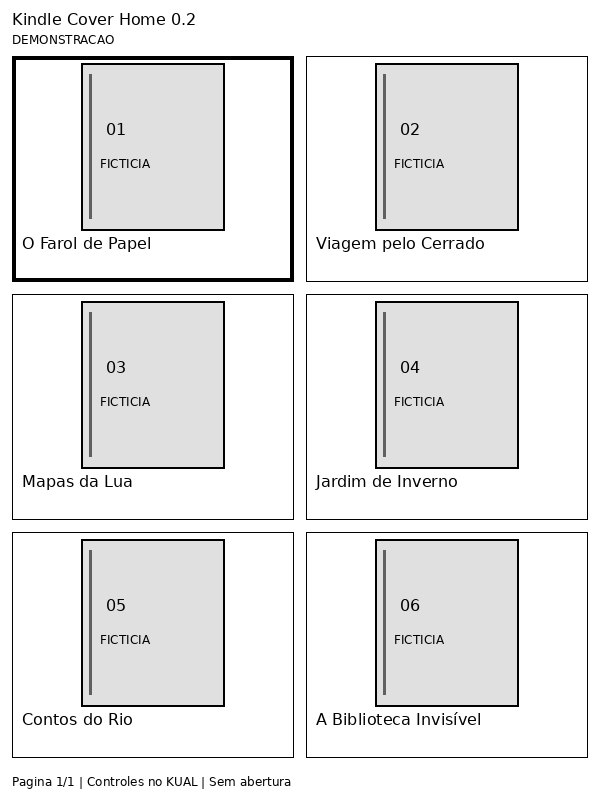

# Kindle Cover Home 0.2.0 — biblioteca visual experimental

Alvo: Kindle Basic 2012 **B023 / firmware 4.1.4**, jailbreak e KUAL-KDK existentes.
A implementação da Etapa 1 foi preservada: scanner, diagnóstico, bloqueio e catálogo
continuam iguais; o menu os chama por um novo wrapper para registrar execução.
Veja o [README original](docs/stage-1-README.md).

**Não testado em Kindle real.** Esta versão inclui imagens executáveis por uma
ferramenta nativa candidata (`eips -g`), com ativação manual. Não oferece uma GUI
interativa independente validada. O sistema Amazon continua ativo e pode repintar
a tela imediatamente. Se isso ocorrer, a abordagem não passou pelo portão de
compatibilidade: não parar o framework nem capturar botões para contornar o problema.



## O que está implementado

- Payload KUAL 0.2.0 e ZIP USB em `dist/kindle-cover-home-0.2.0.zip`.
- Etapa 1 intacta; diagnóstico, início e conclusão registrados em
  `/mnt/us/coverhome/logs/session.log`, com uma execução anterior em `previous.log`.
  O diagnóstico legado continua em `/mnt/us/kindle-cover-home-data/diagnostics.txt`.
- Renderizador no **computador**, PNG grayscale 600 × 800, seis células, título,
  seleção, páginas e estado vazio; seis capas fictícias já incluídas no ZIP.
- Catálogo (`tools/library_model.py`), capas (`tools/covers.py`), renderização
  (`tools/render_library.py`), navegação (`bin/navigation.awk`) e saída (`bin/render.sh`)
  separados. O redutor de navegação também roda via awk no Kindle.
- Controles oferecidos como comandos do **menu KUAL**, operados por seus botões
  físicos. Nenhum leitor evdev ou captura global; não há processo aguardando teclas.
- Capas externas de MOBI/AZW e extração EPUB no computador quando informado um
  catálogo com EPUB. Arquivos de livros só são lidos; nenhum banco Amazon é aberto.
- Abertura de livros indisponível: selecionar apenas registra o índice no log.

## Instalar ou atualizar 0.1.0 pelo Windows

1. No GitHub, use a branch **development**. Baixe o arquivo ZIP em `dist/` usando
   **Download raw file**. Extraia-o no computador; não use o ZIP do código como
   se já fosse o payload instalado.
2. Conecte o Kindle por USB e identifique `X:`, a unidade que contém `documents`.
3. Se houver `X:\extensions\kindlecoverhome`, copie-a para backup **no PC** e
   remova só essa pasta da unidade. Preserve `kindle-cover-home-data`, `documents`,
   KUAL e todas as outras extensões. Não deixe backup de extensão em `extensions`,
   pois o KUAL pode listar menus duplicados. Não mescle versões.
4. Copie `extensions\kindlecoverhome` do pacote para
   `X:\extensions\kindlecoverhome`. A estrutura final contém `config.xml`,
   `menu.json`, `bin` e `ui`. Não copie `tools` para o Kindle.
5. Ejete com segurança e desconecte. Abra o KUAL e execute
   **Diagnostico 0.2 (coverhome/logs)**. Reabra a unidade e confira
   `X:\coverhome\logs\session.log`: deve ter versão 0.2.0, `mode=diagnose`,
   dados coletados e `completed mode=diagnose`. Só a existência de um log antigo
   não comprova a execução. Consulte data e modo; o relógio do Kindle pode estar errado.
6. Teste **Iniciar Kindle Cover Home** e o catálogo demonstrativo da Etapa 1.
   Compare as saídas com a versão anterior e confirme que a Home e os livros originais
   continuam funcionais. Isso ainda precisa ser feito no aparelho.

Os scripts são LF/UTF-8 sem BOM e são chamados por `sh`; não requerem `chmod` em
FAT. Python, Pillow e Node **não são necessários no Kindle**.

## Executar o primeiro ensaio gráfico

Primeiro siga o [roteiro real](docs/device-validation-0.2.md). O modo visual fica
bloqueado por padrão: a existência de `eips` não confirma suporte a PNG nem convivência
com KUAL. A ajuda local e o teste de desenho precisam ser observados no B023.

Após verificar no aparelho que `/usr/sbin/eips` oferece `-g` para PNG e aceitar o
ensaio de uma imagem única, crie um arquivo vazio **sem extensão**:
`X:\coverhome\enable-eips`. Em PowerShell no Windows:

```powershell
New-Item -ItemType File -Path 'X:\coverhome\enable-eips'
```

Troque `X:` pela unidade correta; não habilite sem verificar o mecanismo. Se não
houver como verificar a ajuda local, permaneça no diagnóstico e compartilhe esse
bloqueio antes de avançar. Em um shell já disponível no dispositivo, consulte a ajuda
local (`/usr/sbin/eips -h`) e registre a saída; não instale SSH ou ferramentas extras
como pré-requisito desta versão.

Ejete, abra **Biblioteca visual 0.2 - experimental → Mostrar demonstracao**.
O comando efetivo é `/usr/sbin/eips -g CAMINHO_DA_IMAGEM`. Não chama `-c`, não
escreve diretamente no framebuffer, não suspende o framework nem abre eventos.
Verifique visualmente se as seis capas aparecem e permanecem legíveis. O retorno
zero do comando não prova o resultado visual. Se a tela for repintada, registre a
falha e desative o ensaio; não é uma biblioteca utilizável ainda.

Use os itens Cima/Baixo/Esquerda/Direita e próxima/anterior no menu KUAL para mudar
estado e emitir outra imagem. O foco permanece sob controle do KUAL: **não é o mesmo
que pressionar direcional sobre uma grade com foco próprio**. Se a imagem ocultar
o menu, não navegue às cegas: use Back/Home para recuperar a tela Amazon e encerre
o ensaio. Escolha **Encerrar sessao / retornar ao KUAL** para apagar estado; depois
Back no KUAL volta ao menu anterior. Não há serviço a encerrar. Remova o marcador
`enable-eips` por USB para desativar a saída gráfica.

## Biblioteca pessoal e capas — preparação no computador

A demonstração já está pronta. Para livros reais, gere o catálogo pela Etapa 1 e
conecte por USB. No computador com Python 3.10+ (testado com 3.12):

```powershell
py -m pip install -r tools/requirements-dev.txt
py tools/render_library.py X:\kindle-cover-home-data\catalog.tsv prepared-library --usb-root X:\
```

Execute na raiz do código extraído. `prepared-library` deve ser uma pasta nova;
para reconstruir use outro nome e depois substitua a pasta preparada. Com o Kindle
conectado e nenhum comando executando, copie o **conteúdo** dessa pasta para
`X:\coverhome\library`, substituindo uma biblioteca preparada anterior somente
após backup. Ejete e use **Mostrar catalogo preparado no PC**. Não mistura dados
fictícios e reais. Catálogo sem livros gera uma tela vazia. O limite é 600 entradas;
existem até seis PNG por página (um por seleção), com custo proporcional em USB.

A geração remapeia apenas `/mnt/us/` para a unidade informada. As capas candidatas
fora dessa unidade são rejeitadas. Usa sidecars associados pelo scanner e placeholder
se não houver capa. Não extrai imagens internas de MOBI/AZW nem contorna DRM.
O scanner original não lista EPUB; o módulo de capas aceita EPUB de catálogo
compatível fornecido à parte, com `format=epub`, e procura OPF cover-image/cover id.
Não há descoberta automática de EPUB nesta versão. O leitor Amazon 4.1.4 não passa a
suportar EPUB por causa disso. Os títulos continuam inferidos e autores desconhecidos.

## Remover ou reverter

Feche o KUAL, conecte por USB e apague somente `extensions\kindlecoverhome`.
Opcionalmente apague `coverhome` (logs, marcador, estado e páginas preparadas) e
`kindle-cover-home-data` (saídas da Etapa 1), após backup. Preserve `documents`.
Para voltar à 0.1.0, copie o payload do ZIP antigo após remover o novo; os dois ZIPs
ficam em `dist/`. A Home não foi substituída e não requer restauração de firmware.

Linux/macOS/WSL: `sh tools/install.sh /raiz/USB` recusa instalação existente;
`sh tools/uninstall.sh /raiz/USB` remove arquivos conhecidos, preservando dados e
arquivos extras. Nenhum script é necessário para a instalação manual pelo Explorer.

## Testar no computador

```sh
python3 -m pip install -r tools/requirements-dev.txt
python3 -m unittest discover -s tests -v
python3 tools/package.py
```

Testados catálogo, preservação dos livros, instalação/remoção, logs, escape TSV,
bloqueio gráfico, navegação sem acesso a evdev, páginas/vazio e descoberta de capas.
Pillow e a fonte DejaVu distribuída com sua licença são ferramentas **do computador**.
A prévia é uma imagem gerada; nenhum teste em nuvem valida refresh, foco, botões,
KUAL-KDK ou firmware real. Veja [pesquisa e limites](docs/stage-2.md).
